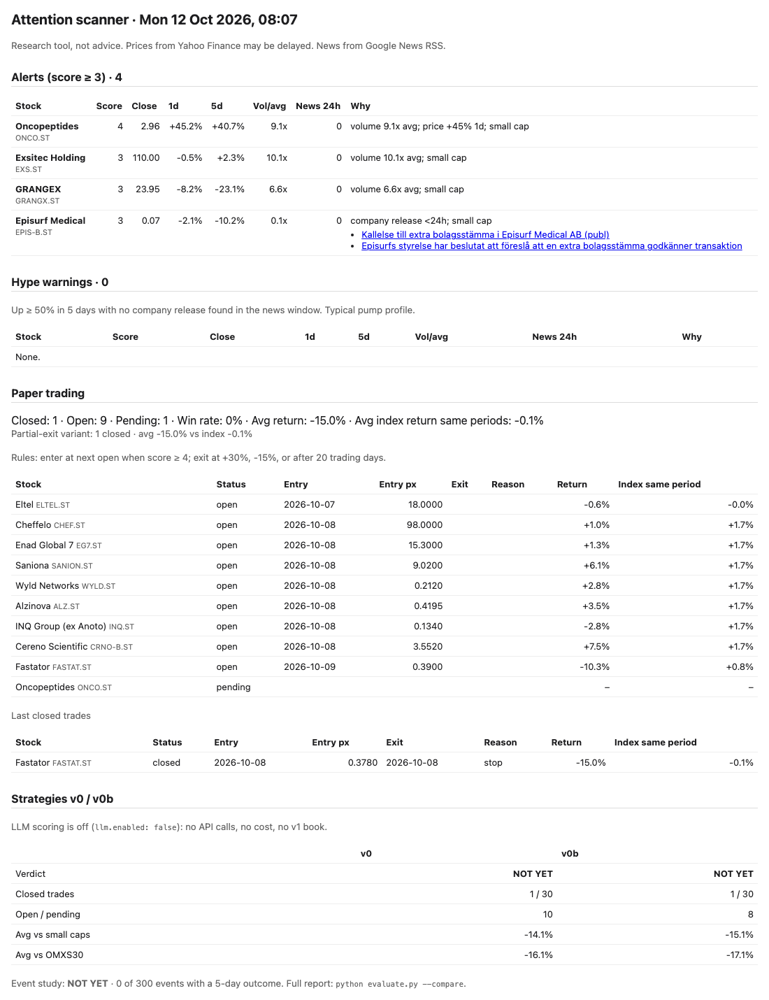
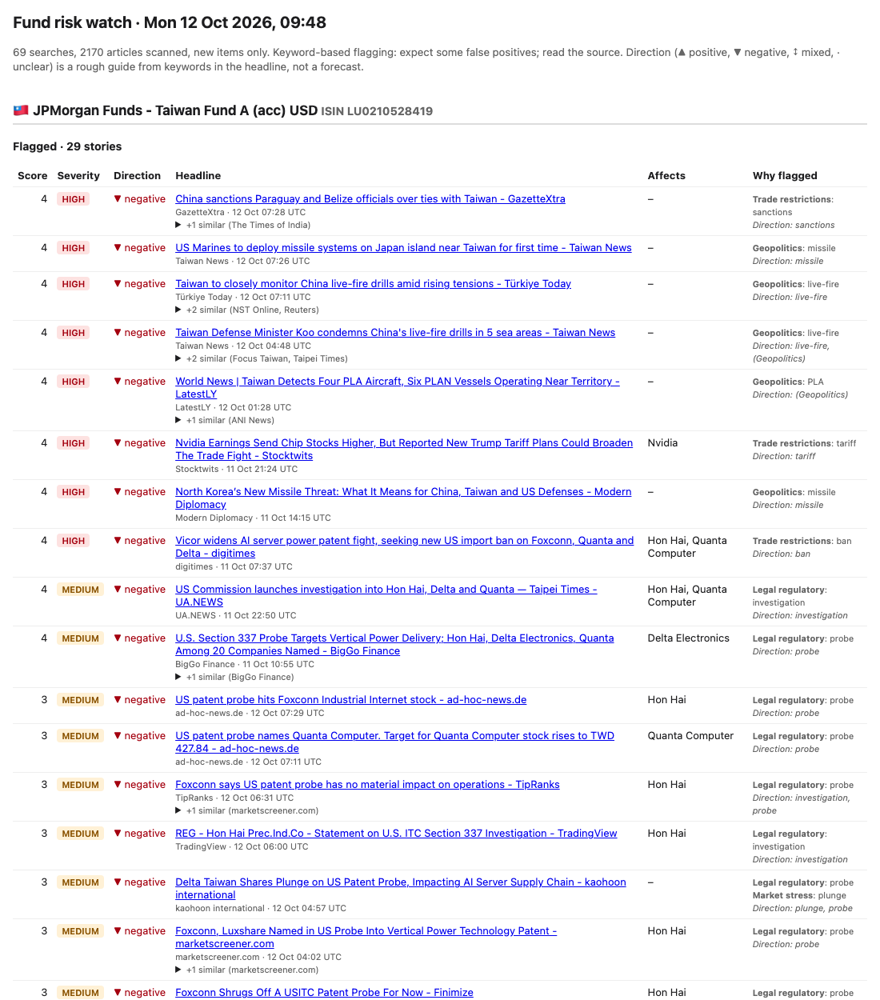

# Stockholm small-cap attention scanner

[](https://github.com/kwagyei/stock-scanner/actions/workflows/ci.yml)

Does a sudden burst of attention on a small Swedish stock — a company release, a volume
spike, a big one-day move, a flurry of news — predict that it will beat the market over the
next few weeks? Plenty of tools *show* signals like these. Very few check, honestly and after
costs, whether acting on them would have made money.

This project does both. Twice a day it scans ~100 Stockholm small caps, scores each one on a
fixed set of rules, opens **paper trades** (it never places real orders) and keeps score
against the small-cap index. A pre-registered evaluation decides **PASS / FAIL / NOT YET**,
and it stays *NOT YET* until there is enough data to mean something. A second tool watches
the news for risks to two funds and labels each story with a likely direction.

| Daily digest | Fund risk watch |
|---|---|
|  |  |

## How it works

```
 Yahoo Finance ──┐   daily OHLCV; days Yahoo leaves blank are filled from Nasdaq Nordic
 Nasdaq Nordic ──┤   small-cap index (benchmark), bid-ask spreads, missing closes
 MFN press feed ─┤   each company's own releases, full text           ┌─> paper trades (v0, v0b)
 Google News ────┘   news volume per company                          │
                    │                                                 ├─> evaluation: PASS / FAIL / NOT YET
                    v                                                 │
          score each stock (config.yaml)  ── signals log, score log ──┼─> dashboard + digest + weekly summary
                                                                      │
                                                                      └─> event study (LLM experiment, off)
```

| Signal (rules fixed in `config.yaml`) | Points |
|---|---|
| Company release in the last 24h | +2 |
| Volume ≥ 5× its 60-day average (≥ 3× gives +1) | +2 |
| Price move ≥ ±10% in one day | +1 |
| News spike: ≥ 3 items in 24h and ≥ 3× the week's daily average | +1 |
| Market cap < 5 bn SEK (only amplifies another signal) | +1 |

Score ≥ 4 opens a paper trade at the **next** day's open; it exits at +30%, −15% or after
20 trading days. Every trade is compared with the Stockholm small-cap index over exactly the
same days, after costs.

## Design decisions

- **Forward paper trading, not a backtest.** Results build up slowly, but there is no
  look-ahead and no survivorship bias, and the rules can't be quietly fitted to history.
  The rules are fixed; changing them would reset the experiment.
- **A verdict that is allowed to say "not yet".** PASS needs ≥ 30 closed trades, a positive
  average excess return after costs, still positive with the single best trade removed, and
  t > 2. Anything less is FAIL or NOT YET. Costs are 0.1% commission plus half the bid-ask
  spread per side (the spread logged when the signal fired, else 0.5%).
- **The right benchmark.** Small caps are judged against the OMX Stockholm Small Cap index
  (from Nasdaq Nordic, since Yahoo has no usable history for it), with OMXS30 shown alongside.
- **Guard rails against bad data.** Today's half-formed daily bar is ignored until after the
  close; a bar older than one already scored is refused (Yahoo sometimes drops the latest
  day around midnight); days where Yahoo has no closing price are refilled from the
  exchange's own daily data. Each of these came from a real incident and has a test.
- **Primary sources over aggregators.** Company releases come from MFN's per-company feed
  (which also carries Cision), because Google News indexes almost none of them.
- **Experiments run side by side, never on top of each other.** `v0` (the original rules)
  and `v0b` (only primary releases count, timed to when a trade was actually possible) are
  separate paper books with the same exits and costs. An LLM-scored `v1` book is built and
  tested (Claude with a JSON schema, a fingerprint that refuses edited prompts, a cost cap)
  but **off by default** so the project runs at zero cost.
- **Free and unattended.** GitHub Actions runs the jobs; an external timer (cron-job.org)
  triggers them because GitHub's own schedule proved unreliable. Each run carries a "slot",
  so a backup or a late duplicate trigger skips itself instead of scanning twice.
- **Code and generated data live apart.** Runs write to a separate private data repository
  (`SCANNER_STATE_DIR`), so this repository's history is code only.

## Repository layout

| Path | What |
|---|---|
| `scanner.py` | Fetch, score, paper-trade, write the dashboard and reports |
| `evaluate.py` | The verdict (CLI and library): per-strategy comparison, event study |
| `strategies.py` | Release timing and the v0 / v0b / v1 scoring |
| `news_sources.py`, `llm_score.py` | Company releases from MFN; optional LLM scoring |
| `build_watchlist.py` | Rebuilds the universe from Nasdaq's share list, filtered on liquidity |
| `fund-watch/` | Fund news risk watch (see [`fund-watch/FUND_WATCH.md`](fund-watch/FUND_WATCH.md)) |
| `config.yaml`, `watchlist.csv` | All thresholds and the universe |
| `tests/`, `fund-watch/tests/` | Offline test suite: every network call is mocked |
| `deploy/data-repo/` | The scheduled workflows, as deployed in the private data repository |
| [`docs/OPERATIONS.md`](docs/OPERATIONS.md) | Setup, scheduling, reading the results, maintenance |

## Running it

```bash
python -m venv .venv && source .venv/bin/activate
pip install -r requirements-dev.txt
python scanner.py --no-email          # one scan; writes data/, reports/ and DASHBOARD.md here
python evaluate.py --compare          # the verdict per strategy
python fund-watch/fund_watch.py --no-email
```

Set `SCANNER_STATE_DIR` to write the output elsewhere. Scheduling with GitHub Actions and the
external timer, e-mail, and how to read every page are in [docs/OPERATIONS.md](docs/OPERATIONS.md).

## Testing

```bash
ruff check . && ruff format --check . && python -m pytest -q
```

~400 tests, all offline: price, news, MFN, Nasdaq and Anthropic calls are mocked, and a
socket guard fails any test that touches the network. They focus on the parts that are easy
to get subtly wrong: trade entry and exit on gap days, timezone and holiday handling for
release timing, data-gap repair, cost and benchmark arithmetic, the statistics behind the
verdict, log migrations, and keyword matching against real headlines that once fooled it.
CI runs lint and tests on every push and pull request.

## Known limitations

- **No evidence yet.** The paper books started in October 2026; every verdict is NOT YET.
  Until ~30 trades per strategy have closed, nothing here says the signals work.
- **Idealised fills.** Trades fill at the open price. Thin small caps often can't be bought
  there in size, and the logged spread is a snapshot at scan time, not at the next open.
- **Daily bars only.** Moves within a day are invisible; stops and targets are checked
  against the day's high and low, stop first.
- **Unofficial data sources.** Yahoo Finance, Google News RSS and Nasdaq Nordic's public
  endpoints are undocumented and can change without notice. Failures are logged and shown
  in the reports rather than swallowed, but a changed endpoint will need a code change.
- **Keyword matching.** News signals and the fund watch's risk and direction labels read
  words, not meaning: commentary ("Forget the selloff: …") and op-eds get mislabelled.
- **One large module.** `scanner.py` (~2,800 lines) mixes fetching, scoring and report
  rendering; splitting the report builders out is the next refactor.
- **The LLM experiment is untested in production.** It is fully built and unit-tested, but
  has never scored live releases, so its value is unknown.

Research and alerting only — not investment advice, and it never places orders.
